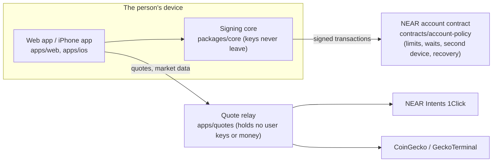

# ZeroFee: a NEAR confidential wallet for every chain.

**ZeroFee is a mobile app: it runs on your iPhone.** There is also a web wallet build (B), with fewer protections.

Any coin on any chain in. Any coin to any wallet on any chain out, through NEAR Intents. The middle of every Send is
hidden; the step in and the step out are public. Your keys never leave your phone.

**Every key on a ZeroFee account is post-quantum (ML-DSA-65), and the rules that guard the money live in the account
itself, in a Rust contract on NEAR.** NEAR supports ML-DSA-65 access keys, so the classical key is deleted and the
account has none left. You can check both on chain in one call (below).

The rules: a limit per payment, a wait above it that the account's phone can cancel, a second device for big payments, and
recovery from 24 words with a wait that the phone or the second device can stop. Each key may call only its own methods, and NEAR
itself enforces that. In Release 10 (not yet published) the second device can also turn down anything the phone asked alone; that
pauses the phone's Face ID spending for a change's wait (72 hours on the app's default), and the 24 words can end the pause at once.
A second device that keeps saying no holds the phone's own changes until its removal runs (at least 10 days on the app's default):
the words only end the pause, they never make a change run.
No ZeroFee server holds anyone's money or keys. The relay does keep the email addresses for alerts, and it sees the details of the
Private payments it passes on.

Built for NEAR HACKATHON. Tracks: **06 AI Security & Defense** (primary), **07 Agent Economy**, **03 Privacy & Private
AI**, **01 Unstoppable DeFi** and **13 Open Innovation**. See [the release](#release-3-nov-2026) and
[How NEAR fits in, track by track](#how-near-fits-in-track-by-track).

## Host it yourself

**This is the first release, a beta. Use small test amounts. You run your own copy, so any loss of funds is your responsibility. The code comes with no warranty (see [LICENSE](LICENSE)).**

There is no ZeroFee app to download. You build your own copy from this code. It is yours: your keys stay on your phone.
Start with the iPhone app (A).

### A. The iPhone app (needs a Mac with Xcode)

You need: a Mac, Xcode 26 or later (free in the Mac App Store), an iPhone on iOS 26 or later, a USB cable, and an Apple
account (a free one works).

1. On the Mac, install Node 24 or later from nodejs.org.
2. Open Terminal (the Mac's command window).
3. Type `git clone https://github.com/OWNER/REPO zerofee` and press Return.
4. Type `cd zerofee` and press Return.
5. Type `npm ci --ignore-scripts` and press Return. This gets the code's parts (about a minute).
6. Type `bash apps/ios/build-web.sh` and press Return. This builds the app's screens.
7. Open `apps/ios/ZeroFee.xcodeproj` in Xcode (double-click it in Finder).
8. In Xcode's left list, click **ZeroFee** at the top, then the **ZeroFee** target.
9. Click **Signing & Capabilities**. Keep **Automatically manage signing** on.
10. Under **Team**, pick your Apple account. No team yet? Choose **Add an Account** and sign in.
11. Change **Bundle Identifier** from `si.zerofee.app` to a name of your own, like `com.yourname.zerofee`.
12. On the iPhone: Settings → Privacy & Security → **Developer Mode** → on. The iPhone restarts.
13. Plug the iPhone into the Mac. Tap **Trust** on the iPhone.
14. In Xcode's top bar, pick your iPhone as the place to run.
15. Press the **Run** button (the triangle). Xcode puts the app on your iPhone.
16. If the iPhone says "Untrusted Developer": Settings → General → VPN & Device Management → your account → **Trust**.
    Then open ZeroFee again.

With a free Apple account the app works for 7 days. Then it stops opening. Plug the iPhone in and press Run again.
Never delete the app to fix it: deleting it erases its keys. Keep your 24 backup words safe. A paid Apple Developer
account ($99 a year) makes each Run last a year.

**Test money first, then real money.** The app opens on NEAR testnet (test money, worth nothing). Try it there
first: make your account, write down your 24 backup words, and send a little test money.

**Real money (mainnet).**

**This is the first release, a beta. Use small test amounts. You run your own copy, so any loss of funds is your responsibility. The code comes with no warranty (see [LICENSE](LICENSE)).**

Real money: start with a small amount. Write down your 24 backup words before any money goes in: they are the only way
back if the phone is lost.

17. In Xcode's left list, click **ZeroFee** at the top, then the **ZeroFee** target.
18. Click **Build Settings**. Click **All** (not Basic) at the top.
19. In the search box, type `ZF_START_QUERY`. It is under **User-Defined**.
20. Double-click its value and type `mainnet`. Press Return. (Click the arrow next to it to check that both Debug and
    Release say `mainnet`.)
21. In Xcode's top menu: **Product** → **Scheme** → **Edit Scheme…** → **Run** → **Build Configuration** → **Release**.
    Click **Close**. (A real-money copy should be a Release build.)
22. Press **Run** again. The app now opens on mainnet, with real money.

To go back to test money, empty `ZF_START_QUERY` and press Run again.

**Which server it talks to.** Private payments (the hidden middle of every Send) go through one small server, the relay.
Your copy uses ZeroFee's relay, written in `apps/ios/relay-url.txt`. To use your own: put your relay's address on that
file's one line (see C below), then do steps 6 and 15 again. To use none: make the file empty. Then the wallet still
opens, shows balances and receives, but Private payments say "Private payments aren't set up on this phone yet."

### B. A web wallet, from your phone (optional, about 5 minutes)

The web wallet has no Safe: it keeps your words in your browser, under a password. Its Private payments need your own
relay (C).

1. On GitHub, open this code's page and tap **Fork** (your own copy).
2. Open vercel.com and sign in with GitHub.
3. Tap **Add New…** → **Project**.
4. Find your fork and tap **Import**.
5. Change nothing. Tap **Deploy**. It takes a few minutes.
6. Tap the link Vercel shows. That is your web wallet.

Or tap this, which forks and deploys in one go:
[](https://vercel.com/new/clone?repository-url=https%3A%2F%2Fgithub.com%2FOWNER%2FREPO&project-name=zerofee&repository-name=zerofee)
(`OWNER/REPO` is a stand-in until this code is on GitHub.)

The repo root's `vercel.json` sets Vercel's install, build and output folder, so nothing needs typing.

A Chrome extension is in the source and is not ready.

### C. Your own relay (optional)

1. In Vercel: **Add New…** → **Project** → import the same fork again.
2. Set **Root Directory** to `apps/quotes`. Tap **Deploy**.
3. In that project's **Settings → Environment Variables**, add what you want. All are optional:
   `ONECLICK_JWT` and `STATUS_TAG_SECRET` turn on Private payments (a NEAR Intents partner key, and a long random text);
   `ALLOWED_ORIGINS` is your web wallet's address (needed for B); market and node keys (`COINGECKO_API_KEY`,
   `GECKOTERMINAL_API_KEY`, `HELIUS_API_KEY_RELAY`, `FASTNEAR_API_KEY`, `ALCHEMY_API_KEY`) make prices and sends faster;
   `ANTHROPIC_API_KEY` turns on AgentZero's chat. Then **Deployments** → **Redeploy**.
4. Your relay's address is its Vercel link, like `https://your-relay.vercel.app`. Check it: open that link with
   `/v0/health` on the end.
5. iPhone: put that address in `apps/ios/relay-url.txt`, then A's steps 6 and 15.
   Web: in the web project's **Settings → Environment Variables**, add `VITE_ZEROFEE_RELAY` with that address. Also put
   it in `apps/ios/relay-url.txt` and run `node apps/web/src/hosting.ts` (the web page only talks to servers its
   `vercel.json` names). Commit, and Vercel deploys again.

[](https://github.com/OWNER/REPO/actions/workflows/ci.yml)
[](LICENSE)

<!-- DEMO GIF: a 30-second GIF goes here (for example docs/images/demo.gif): Create my account, then Trade. -->
<p align="center"><em>[30-second demo GIF: to be added]</em></p>

## For developers: quickstart (about 2 minutes, sample money)

Needs git and Node 24 or later (`.nvmrc`). No keys, Rust or account.

```sh
git clone <this repository's URL> zerofee && cd zerofee
make dev            # or: npm ci --ignore-scripts && npm run dev
```

Open `http://localhost:5180/?demo`. You see a **SIM** badge and **Create my account**; nothing touches a chain. Then
follow [Do X, see Y](#do-x-see-y-sample-money-about-3-minutes).

**Run your own relay and point the app at it** (one step; ZeroFee's relay answers only ZeroFee's own sites):

```sh
cp apps/quotes/.env.example apps/quotes/.env && PORT=5181 node tools/selfhost/serve.mjs &   # apps/quotes, your keys
VITE_ZEROFEE_RELAY=http://localhost:5181 npm run dev                                       # the app, using it
```

**Self-host it** (the built app and its quote relay on one port, your own keys optional):

```sh
cp .env.example .env   # optional: every key is optional and explained in the file
make selfhost          # or: bash tools/selfhost/run.sh  ->  http://localhost:5180/
```

**Check everything** the way CI does, on a fresh clone: `make verify` (install, typecheck, tests with no network, build).



Security model in one line: keys stay on the device, the account's own contract enforces the rules, and the relay only
passes quotes on. Report vulnerabilities privately: [SECURITY.md](SECURITY.md). Contributing:
[CONTRIBUTING.md](CONTRIBUTING.md), [CODE_OF_CONDUCT.md](CODE_OF_CONDUCT.md). Changes: [CHANGELOG.md](CHANGELOG.md).

## Release, 3 Nov 2026

### In it today

- **Home:** one balance and one row per chain we trade on, by its coin: SOL, ETH on Robinhood, NEAR (BNB is off, below).
  Under the balance, one quiet line says what prices did to your coins today. **Move** money between your Safe, Hidden
  and your rows. **Send** any coin to a wallet on another chain, always through Hidden (there is no plain send), from
  your Safe or straight from a row; Hidden from the SOL and ETH on Robinhood rows goes under one Approve. What that hides:
  the middle. The step in and the step out are public and close in time (no wait between them, D137), so money that has
  sat in Hidden for a while is the most private. The guard checks every Send
  first (a sum far bigger than the one you typed is stopped; hidden text in an address is refused). **Swap** one coin for
  another, from your Safe or from Hidden. **Add** money on our chains' coins (SOL, ETH on Robinhood, NEAR, and USDC / USDT on
  them). **Request money**: a link or code anyone can pay from any of those coins. **Scan**: the camera reads a wallet's
  code or a request and opens Send filled in.
- **Safe and Activity:** the Safe's health check lists five plain facts read from your account (backup words checked,
  big payments follow your rules, a second device, the recovery wait, Face ID on the iPhone); a line not done opens its
  fix.
  Activity's **Statement** shows one month in a line and hands you the CSV.
- **Set-up:** words first. ZeroFee gives no address to fund your account until your backup words are checked. Then one
  tap moves $2 of your Safe into Hidden, your first hidden move.
- **Browser:** pump.fun and GMGN as tiles, each with its own wallet and its dollars on the tile. Money goes in from your
  Safe and comes back home with Take out, both through the hidden path; the site opens signed in on the phone.
- **Trade:** buy and sell on the SOL, ETH on Robinhood and NEAR rows. A buy on a listed venue inside the 30-minute trade
  approval goes with no extra sheet, even when only one network server could test it (its line says "Checked by one
  server."); a routed trade (Jupiter) always asks, in plain words, and says why. On every coin page:
  - **Coin safety:** one line that counts, then one plain sentence per check (can anyone freeze it, make more of it, how
    much the top 10 hold); a check with no answer says so.
  - **Since you bought:** what each coin made or lost, from Trade's own record of your buys; a coin with no record says so.
  - **Price orders:** buy if it drops, take profit, stop loss, for up to 7 days.
  - **Standing buys:** $1 to $50 every day or week; all of them together spend at most $100 in any 7 days.
  - **Exit plan** for a coin you hold: sell all if it rises, if it falls, or after a time; the first one to happen ends
    the others.
  - Orders, standing buys and exit plans run while ZeroFee is open, and the next time you open it. Nothing is signed
    ahead: each runs Trade's own trade then, inside your trading limits, or asks you first. A price or time that passed
    while ZeroFee was closed asks you; it never trades by itself.
- **Chat:** rooms, private messages, and money requests that fill in Send. **Tips**: a quiet Tip under a message when its
  author can be paid. **Split the bill**: type the total and how many people; each gets a request in USDC or USDT, and
  your own line counts the payments that reached you.
- **AgentZero on the web:** its chat works in the web wallet too: it reads its own mailbox (a sign-in code shows in its
  Inbox), reads what you hold, prices a swap, and opens Send or Trade filled in, where your password approves. It never
  signs by itself. Its jobs and its browser stay in the iPhone app. Open-source models are coming soon.
- **AgentZero, as landed:** a helper with its own wallet and one limit. It copies a wallet's trades on pump.fun from your
  SOL row inside its own trading day (one Face ID, up to 24 hours, at most $5 a trade and a total for the day), stops
  itself when the row falls 15% from that day's high, and writes a
  receipt for everything, each linked to the one before it, so none can be dropped unseen. The same guard checks your own
  Sends. Before you copy a wallet, its **report card** shows the last 30 days of its pump.fun trades from Solana's own
  record: trades, coins won and lost, and the result in dollars at today's SOL price. Anything it couldn't read says
  "Not known". **Its chat** thinks with Claude (Anthropic) through ZeroFee's relay by default, or your own Claude key;
  the phone swaps every address and NEAR name for a stand-in before anything is sent, so Anthropic and the relay see
  your words but not your addresses. Asking NEAR AI Cloud's enclave model about your Activity, with its proof checked, is
  optional and needs your own NEAR AI key.
- **iPhone:** **Siri and Shortcuts**: "Ask AgentZero" opens AgentZero with your words, and "Send money with ZeroFee"
  opens Send filled in; you type the dollars and approve with Face ID. Siri never hears an amount. **Notifications**:
  AgentZero's and security notifications (a step AgentZero finished just after you left ZeroFee; a new key or a change
  waiting on your account) are one local line, never an amount, coin, address or name. No server sends them. The
  optional email alerts are different: the relay keeps your account's name and your email to send them
  ([apps/quotes/README.md](apps/quotes/README.md)).

### Behind switches, off in this release

- **Every coin 1Click lists** in Add (`ADD_EVERY_COIN`) and in set-up's first money (`FUND_EVERY_CHAIN`).
- **AgentZero's browser** (`VITE_AGENT_BROWSER=1`, one build switch; the public build never sets it).
- **BNB:** off until its first real-money test.
- **Perps:** Trade's Perps tab on Hyperliquid, `PERPS_ON = false`. The build's `PERPS_NETWORK` picks testnet (the default) or mainnet; on mainnet, Put money in and Take out go through Trading by 1Click. Every phone proves its trading key safe on Hyperliquid itself before its first order (the agent is listed, its cancel is accepted, its withdrawal is refused); any failure revokes it.

### Known limits

- If ZeroFee can't read your standing buys, none run until you set them again; the $100 week starts over then.
- Hidden's $100 room trusts ZeroFee's relay to say a request was paid. A wrong answer can let Hidden go over $100; it can't move your money.
- Hidden straight from a row works from the SOL and ETH on Robinhood rows today.
- A notification can only come in the few seconds before iOS pauses ZeroFee. A step AgentZero finishes later shows when
  you next open ZeroFee.
- A wallet that trades with itself on pump.fun looks like real trades on chain, so the leader card can't tell.
- When AgentZero sells from your SOL row, the sale may get up to 20% less than the coin is worth at that moment. The loss
  is limited to what AgentZero bought that day.
- On a computer, "Ask me first" is a promise the ZeroFee tray keeps, because the computer holds AgentZero's key. The daily
  limit on the chain is the hard limit.
- AgentZero trades inside its own trading day: one Face ID, up to 24 hours, at most $5 a trade and a total for the day.
  The day stops itself if your SOL row falls 15% from that day's high. It counts coins at what they cost,
  so a coin's own fall shows only when it is sold.
- Trade's test run is checked by one public server today. Only one free server serves every read it needs: the second
  free server refuses about half the test runs, and the other two refuse the reads. A second server is next.
- The web demo uses sample money. The iPhone app is in testing.

### Honest numbers

- Agent payments by HTTP (x402) report about 196 million payments, but about $42 million settled, and independent reads
  find 25% to 90% of it farmed. $187,861 is verified as paid to services that can be named. The newer Stripe and Tempo
  rail (MPP) shows no volume yet.
- On Virtuals, 151 of 44,052 agents earned over $1,000 (chainward.ai).
- So the rails are real and the demand is thin. AgentZero can pay what it meets because an agent has to, not because
  pay-per-call is the product. What it adds is the limit: one the person signs, kept on chain, with every payment, and
  every refusal, written as a receipt.

### Tracks

| Track | What to look at |
|---|---|
| 06 AI Security & Defense (primary) | the guard on every Send and every AgentZero payment; the account's rules on chain |
| 07 Agent Economy | AgentZero: its own wallet with one limit, a copied wallet on pump.fun, a receipt for everything |
| 03 Privacy & Private AI | Every Send goes through Hidden (NEAR Intents' confidential middle): the middle is hidden; the step in and the step out are public and close in time, so money that has sat in Hidden a while is the most private. AgentZero's chat: by default Claude (Anthropic) through ZeroFee's relay, every address and NEAR name masked on the phone first; NEAR AI Cloud's enclave model is optional and needs your own NEAR AI key |
| 01 Unstoppable DeFi | Trade on three chains, with the session's limits and refunds shown |
| 13 Open Innovation | post-quantum keys on every account, and recovery with a wait you can stop |

## Check it on chain in one call

`zf-78b748d935.testnet` is a real testnet account made by `tools/testnet/account-rules.ts`
([explorer](https://testnet.near.rocks/account/zf-78b748d935.testnet)). List its keys:

```sh
curl -s https://rpc.testnet.fastnear.com -H 'content-type: application/json' \
  -d '{"jsonrpc":"2.0","id":1,"method":"query","params":{"request_type":"view_access_key_list","finality":"final","account_id":"zf-78b748d935.testnet"}}'
```

You get three keys. Every one is `ml-dsa-65-hash:…`, and every one is a function-call key whose receiver is the account
itself. There is no `ed25519` key and no `FullAccess` key:

| Key | Methods NEAR lets it call |
|---|---|
| the phone | `execute`, `run`, `cancel`, `set_protection`, `add_second_device`, `remove_key`, `set_recovery_key`, `cancel_recovery` |
| the second device | `approve`, `decline` |
| the 24 words (recovery) | `start_recovery`, `finish_recovery`, with a 0.25 NEAR fee allowance |

The same request with `"request_type":"view_account"` shows the contract on it: `code_hash` is
`BELFgu4XArJjV2BJBtcfG2L16vKnF2a222kPt28pTcoB`, an early build of the account contract (made 25 Oct 2026).

## Facts a reviewer needs

| Fact | Value |
|---|---|
| What it is | A phone-sized money app (a web demo, and an iPhone app in testing) that holds money under on-chain rules. |
| Problem | Wallets put a company, a server or one seed phrase between people and their money. Their keys are classical, so a future quantum computer could forge them. |
| Mainnet | **Release 9 of the account contract is published on NEAR mainnet** (1 Nov 2026), as a global contract by its code hash (verify it by that hash). **The app's mainnet build is dust-only and in testing**; it is not part of this demo. See [Release 9 on mainnet](#release-9-on-mainnet). |
| Testnet | The app's alpha, and the accounts and transactions linked in this README. |
| Local demo | `npm ci --ignore-scripts`, then `cd apps/web && npm run dev`, and open `http://localhost:5180/?demo`. **Sample money only.** No Rust, wallet, API key or env var needed. Steps below. |
| Hosted demo | <https://superapp.zerofee.si/?demo> (sample money only). It may run an older build than this commit; the steps below were checked on this commit, run locally. |
| Contract | `contracts/account-policy/` (Rust, `near-sdk` 5). Release 9: `release_version()` returns 9; wasm sha256 `75af028ee153d7c341bc4f96b9ba10a4b2fada5b2170e5e07d3d13b7be735e70`, NEAR code hash `8vPUrwYWp5cPDJGEuMg73d5tCJM29YkhytTsJR33AAyu`. |
| Audit | [docs/audit/](docs/audit/): the independent SI audit (Report 1.2, which covers Release 6) and [Release 9's own evidence](docs/audit/RELEASE-9.md), audited by SI agents. No outside firm has reviewed Release 9. Both are markdown, readable without JavaScript. Release 10 (the `-10` files in `contracts/account-policy/release/`) passed four internal audits in a row with no changes needed (separate AI review sessions); it is not published yet. New accounts on mainnet today get Release 9 (the unversioned files), the published global contract. |
| Licence | [Apache-2.0](LICENSE), with a [NOTICE](NOTICE). Anyone may use, change and share it. |
| Window | First commit 24 Oct 2026, after the 19 Oct announcement. See [Built in the hackathon window](#built-in-the-hackathon-window). |
| Chain Signatures | Not used. |
| Tests | `npm test` and `npm run typecheck` from the repo root, no network needed. |

## Do X, see Y (sample money, about 3 minutes)

Run the local demo (see [Run it locally](#run-it-locally)) and open `http://localhost:5180/?demo` in a phone-sized
window (390 x 844). Every step below was walked on this commit in headless Chrome at 390 x 844, with a screenshot of each
screen.

1. **See:** "ZEROFEE · Own what's yours." and a **Create my account** button.
2. **Do:** tap **Create my account**.
   **See:** the account's five steps at the top (Words, Money in, Protected, Second device, Done; Words under way), then
   "Write these down": 24 words, the line "Recovery wait: 48 hours · Change", and two warnings. 48 hours is already set.
3. **Do:** tap **I've written them down**.
   **See:** "Which is word N?" with four words. **Do:** tap the right word, three times.
4. **See:** Home. The ZeroFee mark at the top, then the five steps with Second device next: "More than $5,000 is here. Add a
   second device." Then "Your money $5,426.69" and two pots: **Safe** $5,254.15 ("Under your account's rules", with **Add**
   and **Send**) and **Spending** $172.54 ("of $500", with **Top up** and **Put away**), three coins and "Show all 5 coins",
   then "Your account": **Protection**, **Devices**, **Recovery**, **Activity** and **Details**.
   The bottom row: **Home**, **Trade**, **Chat**, **pump.fun** and **GMGN**.
5. **Do:** tap **Devices**.
   **See:** "The demo's key is a sample key" with **Details**, then "Second device · Only this device" with **Add my laptop**
   and **Add a guardian**. Tap the arrow to go back.
6. **The hold.** **Do:** tap **Send** in the Safe. Type `alex.near`; the amount shows under it once the name is found. Type
   `1000` on the keypad and tap **Send $1,000.00**.
   **See:** the Approve sheet: "Check this · Send $1,000.00 (1000 USDC) to alex.near · Amount: $1,000.00 (1000 USDC) ·
   Details: on NEAR · Over $500 in 24 hours: it waits 1 day. You can cancel it until then." with **Approve** and **Not now**.
7. **Do:** tap **Approve**. (The sample demo asks for no passkey: its key is a sample key.)
   **See:** "Waiting · 23h 59m", the time it ends, "Send 1000 USDC", "Big payments wait, so you can stop one you didn't
   make." and "Nothing has moved yet. Your money is in your Safe.", with **Done**, **Cancel it** and **Skip ahead**.
8. **The cancel.** **Do:** tap **Cancel it**.
   **See:** "Check this · Cancel: Send 1000 USDC · Nothing from it goes out. · Network fee: at most 0.001 NEAR."
   **Do:** tap **Approve**.
   **See:** "Cancelled. Your money hasn't moved. It's in your Safe." Tap **Done**.
9. **Trade.** **Do:** tap **Trade** in the bottom row.
   **See:** Trade, headed by your Spending ($172.54 in the sample). Trade pays from Spending, never from the Safe.
10. **Chat.** **Do:** tap **Chat**, type `Zurich` in the city field, and tap **Zurich · Switzerland**.
    **See:** a notice that anyone can post here and "Never pay because a message asks." **Do:** tap **I understand**.
    **See:** "Zurich · Connected · you are anon" and four digits, with **Post** and **Request money**.
    Chat is live, not sample: it talks to BitChat's public message servers, so anything you post is public.
11. **Every app.** **Do:** go back to **Home** and swipe up on the bottom row (or tap its grab bar).
    **See:** "All apps": Home, Trade, Chat, pump.fun, GMGN, Jupiter, Raydium, Orca, Kamino and Sanctum, and "Hold an app to
    keep it in your bottom row." Swipe down to close it.

Steps 6 to 8 are the contract's band rule. On testnet the same hold and cancel are real transactions:
[6BawXMbz…](https://testnet.near.rocks/tx/6BawXMbztoGcE1hArTuUV6LpYpEFRddheRYaCyT7VGa7) (held) and
[22NgVq2q…](https://testnet.near.rocks/tx/22NgVq2qociA6vMAJsTL9W9GihyGf6bskjbAur2RsEES) (cancelled).

The sample demo runs on `packages/shell-api/src/MockBridge.ts`. It signs nothing and sends nothing to any chain. Two parts
read the live internet: Trade reads public Solana nodes and coin pictures for its list, and Chat connects to BitChat's
public message servers.

## How NEAR fits in, track by track

Each track below names what is built today and where to check it. Testnet links go to
[testnet.near.rocks](https://testnet.near.rocks), FastNear's explorer; mainnet links go to nearblocks.io.

### 06 AI Security & Defense (primary)

- **The account says allow, wait or stop before money moves, and NEAR enforces it.** The account contract checks every
  payment against the account's bands: a small one goes at Face ID, one over the limit waits and can be cancelled, a big
  one needs the second device's yes. The keys can't get around it: each is a NEAR function-call key limited to its own
  methods on its own account.
- **Warnings before Approve.** The sheet warns on a first payment to an address, a large amount, an unknown contract, a key
  change, and a simulation that disagrees with what the sheet says (`packages/core/src/signer.ts`).
- **Proof on testnet:** a payment held ([6BawXMbz…](https://testnet.near.rocks/tx/6BawXMbztoGcE1hArTuUV6LpYpEFRddheRYaCyT7VGa7)),
  the same payment cancelled ([22NgVq2q…](https://testnet.near.rocks/tx/22NgVq2qociA6vMAJsTL9W9GihyGf6bskjbAur2RsEES)), a
  payment held for the second device ([AVdLawwG…](https://testnet.near.rocks/tx/AVdLawwGMo3s6wkhV735YvpGxoW6qEds6NYhVM8WtTfB))
  and its yes ([HdUmGUkQ…](https://testnet.near.rocks/tx/HdUmGUkQoqxEK1s7xWWK4s6wx45e35yQTGpWQANVtAVY)).
- **Release 10 (in this source, not yet published):** a separate key for an AI agent with its own daily limit
  (`contracts/account-policy/src/agent.rs`, in Release 10's wasm). Mainnet runs Release 9, which has no agent key.

### 12 Social Money

- **Chat with money in it.** Chat is BitChat-compatible: a city's public room on BitChat's own message servers (Nostr
  relays), and private messages. A message like "send 5 USDC to …" or a **Request money** post only fills in Send. The
  payment itself is a NEAR transaction from the payer's own account, under that account's bands and Approve sheet.
- **Requests know when they're paid.** A paid request shows "Paid" with its link and never offers Pay again, from this
  device's record or the account's own Activity (`packages/chat/src/paid.ts`).

#### How NEAR fits in Chat

The messages still travel as Nostr events, so city places stay BitChat-compatible. NEAR carries who you are, names,
rooms and money:

- **Your name is your NEAR account.** In a NEAR room your name is your account, e.g. `alice.near`, with a ✓. To get it
  you approve one note on ZeroFee's own sheet (no money moves). The note is NEP-413, signed by your account's own device
  key, and it names your Chat key for 60 days. Your Chat key signs the record of it. No key is added to your account and
  nothing is written on chain. Readers check both signatures. They then ask NEAR, on two nodes, whether the note's key is
  still one of the account's own device keys. A guardian's, recovery or agent key never counts. In a city place you stay
  anonymous unless you turn on **Show my NEAR account** for that place. That uses a separate key for the place, so what you
  said there before stays without a name. Code: `packages/core/src/chat-near.ts`, `chat-keys.ts`, `chat-reads.ts`;
  `packages/chat/src/names.ts`. On the phone the chip builds and signs the note itself (`apps/ios/ZeroFee/NearTx.swift`
  `ChatName`).
- **Names work as addresses.** `send 5 USDC to alice.near` and `request 5 USDC from bob.near` look the name up on NEAR
  first, with one `view_account`. A name with no account gets one line and nothing opens. A send opens the one money sheet's Send over Chat
  with the name filled in and "Exists on NEAR". The payment then goes under the account's own rules and Approve sheet,
  as every send does.
- **DAO rooms.** Chat's first screen lists **Your DAOs**: every Sputnik DAO whose `get_policy` names your account, read
  on NEAR. **Open a room** takes any `.near` name or a coin. A DAO's room shows its roles from `get_policy`, and
  members' messages carry their role. Room messages are Nostr events on Chat's own servers, tagged with the room.
  BitChat users don't see them.
- **Profiles:** a person's near.social name, read-only, on their sheet. Their account stays their name.
- **Proof:** a two-person walk on a real testnet Sputnik DAO (`zf-chat-room.sputnik-v2.testnet`) and a real mainnet one
  (`marketing.sputnik-dao.near`), read-only. A real testnet account's name is checked against testnet itself, and an
  impostor's record is folded away as not checked. Unit tests: `packages/core/src/chat-near.test.ts`,
  `packages/chat/src/near-chat.test.ts`.
- **Not yet:** turning a DAO room's request into a treasury proposal. A profile's picture: its host would be a new one on the
  phone's approved list, which is a Security decision. On the public demo, Chat is still "Coming soon".
- **Tiered approval is the contract's bands:** small at Face ID, over the limit a cancellable wait, big needs a second
  device, which can be another person's ("Be someone's guardian" in Security). On testnet:
  [AVdLawwG…](https://testnet.near.rocks/tx/AVdLawwGMo3s6wkhV735YvpGxoW6qEds6NYhVM8WtTfB) (held for the second device),
  [HdUmGUkQ…](https://testnet.near.rocks/tx/HdUmGUkQoqxEK1s7xWWK4s6wx45e35yQTGpWQANVtAVY) (its yes).

### 08 Real-World Money

- **Dollars to anyone.** Send USDC to any `.near` name from the Safe today (Do X, see Y, step 6); a NEAR name is one case:
  sending any coin to a wallet on any chain through NEAR Intents, its middle hidden, is being built. A big payment waits
  and can be cancelled.
- **One dollar line across chains.** USDC held on NEAR, Solana and Base shows as one "USD Coin" line.
- **Money in from other chains through NEAR Intents (1Click).** A new account can be funded with 12 coins on 6 networks:
  NEAR straight to the account, and 11 coins (SOL, ETH on Ethereum, Base, Arbitrum and Robinhood Chain, USDC on Solana,
  Base, Ethereum and Arbitrum, USDT on Ethereum and Solana) through a signed 1Click quote. The core checks each quote
  before it shows an address. Money that can't be swapped at the quoted price is refunded on its own network to the
  account's own wallet there, made from the same 24 words, never to an address anyone types
  (`packages/core/src/fund-start.ts`). NEAR Intents is mainnet-only, so this is not in the sample demo.

### 01 Unstoppable DeFi

- **NEAR Intents, checked, not trusted.** `packages/core/src/intents.ts` and `oneclick-account.ts` check signed 1Click
  quotes and build deposits, conversions and withdrawals; the tests use recorded quotes.
- **Run a real quote yourself, no key needed:** `node tools/fund/quote-every-coin.ts <out-dir>` asks 1Click for a dry price
  and a real signed quote for each of the 11 coins, and checks each with the core's own `checkFundQuote`. The addresses
  come from throwaway keys and nothing is ever sent. It returned 11 of 11 OK on 2 Nov 2026.
- **Trade** buys and sells on Solana and Robinhood Chain from Spending, a capped pot, so the Safe is never exposed
  (`packages/trade/`).

### 13 Open Innovation

- **An account that outlives a lost phone, with nothing classical in it.** The 24 words rebuild a recovery key that NEAR lets
  call only `start_recovery` and `finish_recovery` (see the key list above). The app sets a recovery wait of 48 hours or
  more, and the phone or the second device can stop a recovery during it. A second device can be a person you trust.
- **Proof on testnet:** set-up in one batch that adds the phone's ML-DSA key, deploys the contract and **deletes the
  classical ed25519 key** ([6QLiWG98…](https://testnet.near.rocks/tx/6QLiWG983MRcyYJp1ZHJkLH1zqA7R1uZLkcLgXbJSuCJ)); on
  `zf-5a09dbd737.testnet`, a classical key deleted **by a post-quantum signature** (`DeleteKey`, signed with
  `ml-dsa-65`: [Hus57RQS…](https://testnet.near.rocks/tx/Hus57RQSADpobCmmAXUqfsbDCDyihk5WVb9E4bATGqcM)).

## Verify on NEAR yourself

NearBlocks' testnet index stopped at block 270,420,307 on 27 Sep 2026 (checked 1 Nov 2026), so testnet links go to
[testnet.near.rocks](https://testnet.near.rocks). Each transaction below was read back from
`archival-rpc.testnet.fastnear.com` on 2 Nov 2026.

| What happened | Transaction |
|---|---|
| Set-up in one batch: add the phone's ML-DSA key, deploy the contract, `new`, and **delete the classical ed25519 key** | [6QLiWG98…](https://testnet.near.rocks/tx/6QLiWG983MRcyYJp1ZHJkLH1zqA7R1uZLkcLgXbJSuCJ) |
| **A payment held:** `execute` of 0.6 NEAR, over the 0.5 NEAR band, logs `request_waiting` (request 3) | [6BawXMbz…](https://testnet.near.rocks/tx/6BawXMbztoGcE1hArTuUV6LpYpEFRddheRYaCyT7VGa7) |
| **The same payment cancelled** by the phone: `cancel` logs `request_cancelled` (request 3); nothing was sent | [22NgVq2q…](https://testnet.near.rocks/tx/22NgVq2qociA6vMAJsTL9W9GihyGf6bskjbAur2RsEES) |
| A payment held for the second device (request 7) | [AVdLawwG…](https://testnet.near.rocks/tx/AVdLawwGMo3s6wkhV735YvpGxoW6qEds6NYhVM8WtTfB) |
| The second device's key says yes: `approve` logs `request_approved` and `request_done` | [HdUmGUkQ…](https://testnet.near.rocks/tx/HdUmGUkQoqxEK1s7xWWK4s6wx45e35yQTGpWQANVtAVY) |
| On another account, `zf-5a09dbd737.testnet`: the classical key deleted **by a post-quantum signature** (`DeleteKey(ed25519)` signed with `ml-dsa-65`) | [Hus57RQS…](https://testnet.near.rocks/tx/Hus57RQSADpobCmmAXUqfsbDCDyihk5WVb9E4bATGqcM) |

To read one over RPC (the archival node keeps old transactions):

```sh
curl -s https://archival-rpc.testnet.fastnear.com -H 'content-type: application/json' \
  -d '{"jsonrpc":"2.0","id":1,"method":"tx","params":{"tx_hash":"22NgVq2qociA6vMAJsTL9W9GihyGf6bskjbAur2RsEES","sender_account_id":"zf-78b748d935.testnet","wait_until":"FINAL"}}'
```

**The recovery key can't send money, and no explorer can show that.** A transaction from a function-call key that carries a
transfer is refused by NEAR before it reaches a block (`InvalidAccessKeyError: RequiresFullAccess`), so it has no hash on
chain. Two ways to check it:

- the key's permission above: the 24 words' key may call only `start_recovery` and `finish_recovery`;
- the refusal itself, on a local NEAR node with no keys of ours: the sandbox suite (`tools/mainnet/sandbox-suite.ts`) signs a
  raw payment with the words' key, and with the phone's, and checks that NEAR answers `RequiresFullAccess` (see
  [The on-chain path you can run](#the-on-chain-path-you-can-run)). `tools/testnet/recovery-policy.ts` makes the same attack
  on testnet.

## Release 9 on mainnet

Release 9 of the account contract is **published on NEAR mainnet** as a global contract, by its code hash
`8vPUrwYWp5cPDJGEuMg73d5tCJM29YkhytTsJR33AAyu`
(verify it by code hash). Read the bytes back and
hash them yourself:

```sh
curl -s https://rpc.mainnet.fastnear.com -H 'content-type: application/json' \
  -d '{"jsonrpc":"2.0","id":1,"method":"query","params":{"request_type":"view_global_contract_code","finality":"final","code_hash":"8vPUrwYWp5cPDJGEuMg73d5tCJM29YkhytTsJR33AAyu"}}' \
  | python3 -c 'import sys,json,base64,hashlib; b=base64.b64decode(json.load(sys.stdin)["result"]["code_base64"]); print(len(b), hashlib.sha256(b).hexdigest())'
```

It prints `259249 75af028ee153d7c341bc4f96b9ba10a4b2fada5b2170e5e07d3d13b7be735e70`: the size and sha256 of
`contracts/account-policy/release/account_policy.wasm` (checked 2 Nov 2026).

Two fresh mainnet accounts, set up exactly as the app does, checked it live: only phone and words keys, no full-access key,
a small payment at Face ID, a bigger one held and then cancelled.

**The app's mainnet build is dust-only and in testing.** The public demo is sample money only.

### Release 9's evidence

All of it is in [docs/audit/RELEASE-9.md](docs/audit/RELEASE-9.md), audited by SI agents; the logs are in
`contracts/account-policy/proofs/runs/` (files named `run-r9-*`). From that file:

- the contract's test suite on the frozen bytes: **210 passed, 0 failed, 0 ignored**;
- an explicit-state checker on the real contract, every actor and action to depth 4: 93,413 and 94,784 states,
  **0 counterexamples**; 9 of 9 planted bugs caught;
- Kani: 192 harnesses, **95 proven, 0 failed**, 16 timeout, 8 out of memory, 2 stopped, **71 not run**;
- fuzzing: 87 min 31 s, 928,508 sequences, no contract rule broken;
- mutation testing: 412 mutants, 350 caught, 29 missed, 33 unviable;
- the publish rehearsed on a local NEAR sandbox: **GREEN**, 113 of 113 checks before, 55 of 55 after;
- a blind re-score by a fresh AI reviewer: **81/100**, "I found no way to take funds."

Open item R9-AL1 (Low, a wrong guarantee; no money moves): its fix goes into Release 10. The independent SI audit in
[docs/audit/ZeroFee-Contract-Audit-Report.md](docs/audit/ZeroFee-Contract-Audit-Report.md) covers Release 6, not Release 9.
Nothing here is "unhackable" or "quantum-proof".

## Where to look in 10 minutes

| What | Where | Why it matters |
|---|---|---|
| **The contract** | `contracts/account-policy/src/lib.rs` (about 2,800 lines; Agent's own key in `src/agent.rs`, about 400) | The account's own policy engine: payment bands, holds and `cancel`, the second device's `approve`/`decline`, recovery with `start_recovery`/`finish_recovery`, and a list of allowed releases for `upgrade`. |
| **The core** | `packages/core/src/known-contracts.ts`, `device-key.ts`, `dev-signer.ts`, `tx-build.ts`, `recovery-words.ts` | Which methods each key may call (NEAR enforces these lists) and the release hashes; the ML-DSA-65 keys; the signing pipeline (build the bytes, decode them independently, refuse on any mismatch); how 24 words become the recovery key. |
| **The Spending engine** | `packages/core/src/spending.ts`, `packages/trade/` | The capped everyday pot: Top up from the Safe, Put away back into it, background refills, gas handling. |
| **NEAR Intents** | `packages/core/src/intents.ts`, `oneclick-account.ts`, `fund-start.ts` | Checks signed 1Click quotes and builds deposits, conversions and withdrawals. |
| **Chat** | `packages/chat/` | BitChat-compatible rooms and private messages, and money requests that fill in Send. |
| **The proofs** | `contracts/account-policy/proofs/runs/run-r9-*.txt`, [docs/audit/RELEASE-9.md](docs/audit/RELEASE-9.md) | Test suite, model checker, Kani, fuzzing, mutants and a local-node rehearsal on the frozen Release 9 source. `proofs/` is pinned to Release 9's `src/lib.rs` (sha256 e83ec614…): nothing formal has run on Release 10's bytes. |

## Run it locally

**Needs:** git, Node 24 or later (`node -v`) and npm, and a browser. No Rust, wallet, API key, `.env` file or account is
needed for the Sim. Checked from a fresh `git clone` on macOS with Node 24.13 and npm 11.6.

**1. Get the code and install** (from any folder):

```sh
git clone <this repository's URL> zerofee
cd zerofee
npm ci --ignore-scripts        # installs every workspace from package-lock.json; runs no install scripts
```

**2. Run the Sim** (the app on sample money):

```sh
cd apps/web
npm run dev                    # serves http://localhost:5180; port 5180 must be free (--strictPort)
```

Do: open `http://localhost:5180/?demo` in a phone-sized window (390 x 844 in the browser's device mode).
See: a **SIM** badge at the top, "One wallet for every chain", and **Create my account**. Then follow
[Do X, see Y](#do-x-see-y-sample-money-about-3-minutes). The `?demo` selects sample money: nothing is signed or sent to any
chain. Without `?demo`, the page is the testnet app (see [Testnet](#testnet)). Stop the server with Ctrl+C.

**3. Run the tests** (from the repo root; no network, every outside call is blocked by `tools/test/no-network.ts`):

```sh
node --import ./tools/test/no-network.ts --test packages/core/src/recovery-words.test.ts   # one file, a few seconds
npm test                       # every unit and property test; a few minutes on a laptop
npx tsc --noEmit -p apps/web   # the web app's TypeScript check
npm run typecheck              # every workspace's TypeScript check
```

**4. Build the web app** (optional):

```sh
cd apps/web
npm run build                  # writes apps/web/dist/; Rolldown's dynamic-import notes are expected
npm run preview                # serves the build at http://127.0.0.1:5181/?demo
```

**5. Run the relay** (optional; it holds your keys, never the app's users' keys or money):

```sh
cp apps/quotes/.env.example apps/quotes/.env   # every line is optional; put in your own keys
PORT=5181 node tools/selfhost/serve.mjs        # the relay alone: http://localhost:5181/v0/health
VITE_ZEROFEE_RELAY=http://localhost:5181 npm run dev   # in a second terminal: the app, talking to your relay
```

`make selfhost` builds the app and serves it with the relay on one port instead.

**6. Build the iPhone app** (a Mac with Xcode 26): `npm ci`, then `ZEROFEE_RELAY_URL=<your relay or empty> apps/ios/build-web.sh`,
then open `apps/ios/ZeroFee.xcodeproj`, pick your own team under Signing, and change the bundle id `si.zerofee.app` to one
of yours. No team is set in the repo. Steps: [apps/ios/README.md](apps/ios/README.md).

## Point it at your own servers

ZeroFee's own hosts are only the defaults. Set these to use yours:

| Setting | Where | What it points at | Default |
|---|---|---|---|
| `VITE_ZEROFEE_RELAY` | web build env (`npm run dev` / `build`) | the relay (`apps/quotes`) | none: public APIs, sample money |
| `ZEROFEE_RELAY_URL` | env for `apps/ios/build-web.sh`, the extension build, `hosting.ts`'s CSP | the relay, for the iPhone, extension and CSP | `apps/ios/relay-url.txt` |
| `apps/ios/relay-url.txt` | a file (one https line, or empty) | the same relay, kept in git | ZeroFee's relay |
| `VITE_PHONE_APP_URL` | web build env | the "get the phone app" link | `https://zerofee.si` |
| `VITE_SECOND_DEVICE_SITE` | web build env | the laptop page's host (the second device), and the web note's laptop link | `laptop.zerofee.si` |
| `VITE_CODE_URL` | web build env | the web note's and Settings → Open source's "Get the code" link (your code's https address) | `https://zerofee.si/docs/self-host` |
| `ALLOWED_ORIGINS` | relay env | your site's origin, so the relay answers it | localhost only |
| `BASE` | env for `apps/quotes/deploy.sh` | your deployed relay, for its checks | ZeroFee's relay |
| `DOMAIN` | env for `apps/web/promote-demo.sh` | your demo's domain | ZeroFee's demo |
| `--domain` | `apps/mail/server.ts` flag | your mail domain | `zerofee.si` |

`apps/web/vercel.json` and `apps/ios/connect-hosts.txt` list the hosts the page may reach; add your relay's origin there
when you deploy your own. The relay's settings, one line each: [apps/quotes/.env.example](apps/quotes/.env.example).

## Build and test the contract (needs Rust)

Needs Rust 1.95.0 with the `wasm32-unknown-unknown` target (the pinned `contracts/account-policy/rust-toolchain.toml` installs it
through rustup), `cargo-near` 0.22.0 and `wasm-opt` 133 (binaryen).

The source is Release 10 (`release_version()` returns 10; Agent's own key, `src/agent.rs`). Release 10 is not published;
Release 9's wasm (`release/account_policy.wasm`, `release/SHA256SUMS`) is kept as published and is not rebuilt from this
source.

```sh
# test, from the repo root (one at a time; a whole suite's fuzzers take about 20 minutes)
(cd contracts/account-policy && cargo test)                                                  # default features: short-waits, agent
(cd contracts/account-policy && cargo test --no-default-features --features agent,short-waits)
(cd contracts/account-policy && cargo test --no-default-features --features agent --lib r7_release_minimum)  # the release's own features
# (npm run test:contract runs the first and the last)

# build Release 10 and its sandbox-only short-waits build, then check them against the pins
npm run build:account-policy   # writes release/account_policy-10.wasm, account_policy-10-short-waits.wasm and SHA256SUMS-10
git diff --exit-code contracts/account-policy/release/SHA256SUMS-10   # no change: the build reproduces the committed pins
```

The release wasm is built with `--no-default-features --features agent` (never short-waits). Its sha256 and NEAR code hash
are also pinned in `packages/core/src/known-contracts.ts` (`RELEASE_10`) and the relay's `apps/quotes/safe-code.mjs`;
[docs/audit/RELEASE-10.md](docs/audit/RELEASE-10.md) lists them. The source paths are remapped, so the hash doesn't depend on
where the repo sits.

To check that the shipped Release 9 wasm is the published release without building: `shasum -a 256 contracts/account-policy/release/account_policy.wasm`
must print the sha256 in the facts table.

## The on-chain path you can run

The testnet scripts need the team's funded testnet accounts (see [Testnet](#testnet)). The path that needs no keys of ours is the
release rehearsal on a local NEAR node: the pinned `near-sandbox` 2.13.4 (nearcore), on 127.0.0.1 only, in a throwaway folder.
It sets up accounts with the real Release 9 wasm, holds and cancels payments, runs a recovery, adds a second device, checks the
key-level refusals, publishes Release 9 as a global contract by hash on that local node and checks the accounts after it.
Nothing reaches testnet or mainnet.

Needs Rust (step 0 runs one contract test) and Node 24. The recovery waits are real time, so a run takes most of an hour.

```sh
# the official near-sandbox 2.13.4 build: PLATFORM is Darwin-arm64 (macOS, Apple silicon) or Linux-x86_64
PLATFORM=Darwin-arm64
curl -LO https://s3-us-west-1.amazonaws.com/build.nearprotocol.com/nearcore/$PLATFORM/2.13.4/near-sandbox.tar.gz
tar -xzf near-sandbox.tar.gz
npm ci --ignore-scripts
NEAR_SANDBOX_BIN=$PWD/$PLATFORM/near-sandbox bash tools/mainnet/rehearse.sh
```

`rehearse.sh` refuses any binary whose sha256 isn't one of the two official builds' (Darwin-arm64
`292cbc73…7eec`, Linux-x86_64 `4e89fbc0…a2c2`). It ends with `REHEARSAL GREEN`. The Release 9 round's own run is
`contracts/account-policy/proofs/runs/run-r9-sandbox-rehearsal.txt`: `pre: 113 of 113 checks hold`,
`post: 55 of 55 checks hold`, `REHEARSAL GREEN`. The suite has gained the two raw-payment refusals above since that run.

## What the app is

### Two pots: Safe and Spending

A person sees two pots and nothing else about money.

- **Safe** holds most of the money, under the account contract's rules: a daily limit, a wait above it that can be cancelled,
  a second device for big payments, and the 24-word recovery.
- **Spending** holds everyday money for Trade and Apps, up to a cap the person chooses ($500 by default). **Top up** moves
  money from the Safe into Spending and **Put away** moves it back.

### The apps

**Home** (the two pots, with the account's keys and rules inside it: Protection, Devices, Recovery), **Trade** (buy and sell
coins from Spending), **Chat** (BitChat-compatible messages, and money requests) and each trading site as an app of its own
(pump.fun, GMGN, Jupiter and more in the tray, opened inside
ZeroFee with a small, separate wallet, so the Safe is never exposed to a site).

### The second device

A laptop or a spare phone is a second signing key on the same NEAR account. Once it has come of age, a big payment needs its yes,
and a recovery from the 24 words needs its yes too. Its page is the app's own `/laptop` (at launch, `superapp.zerofee.si/laptop`).
A browser that holds the account refuses to be its own second device (`apps/web/src/mode.ts`).

### Recovery

24 backup words rebuild a recovery key that can do exactly two things: start a move to a new phone, and finish it after the wait
(48 hours at least). NEAR itself refuses that key any payment. The phone, or the second device, can stop the move during the wait.
If the phone, the words and any second device are all lost, the money is gone; the app says so plainly.

## Built on NEAR

| NEAR piece | How the app uses it | Where |
|---|---|---|
| **ML-DSA-65 access keys** | NEAR supports ML-DSA-65 (NIST FIPS 204) access keys. Every key on the account is one, added with NEAR's own key actions; the classical key is deleted. See [Check it on chain in one call](#check-it-on-chain-in-one-call). | `packages/core/`, `tools/testnet/pq-account.ts` |
| **Account-policy contract** | One Rust contract on the person's own account holds the rules: a limit per payment, cancellable waits, a second device, recovery, allowed releases. On mainnet it runs as a NEAR global contract, by code hash: Release 9 is published (1 Nov 2026). On testnet the app deploys the same code's short-waits build (a 60-second shortest wait) directly onto each new account. | `contracts/account-policy/` |
| **Function-call access keys** | The phone's key, the recovery key and the second device's key are each limited by NEAR to their own methods on their own account, so the recovery key can't send money even if the app is bypassed. | `packages/core/src/known-contracts.ts`, `contracts/account-policy/` |
| **NEAR Intents (1Click)** | Funding from 11 coins on 5 other networks, conversions and withdrawals, each from a signed quote the core checks first. Mainnet-only (HACKATHON.md Q-007), so not in the sample demo or the testnet alpha. | `packages/core/src/intents.ts`, `oneclick-account.ts`, `fund-start.ts` |
| **Chain Signatures** | **Not used.** | n/a |

## Testnet

The alpha runs on NEAR testnet.

- **What the app's testnet mode deploys.** The page without `?demo` uses NEAR testnet and deploys the contract's `short-waits`
  build, `contracts/account-policy/release/account_policy-short-waits.wasm` (sha256
  `03a474c3dae06f4f49d78ab50b5bf1d32bd3f39ac72c7277ad0f83b05ec19985`, code hash `FDfoE6vBv1bGjfxWgkXDh8FnEfLjKYFiUvDxUkQnPNL`),
  directly onto each new testnet account. It is the same Release 9 code with a 60-second shortest wait, so a wait can be seen in a
  minute.
- **To try the testnet app,** open `http://localhost:5180/` after `npm run dev`. It asks for NEAR on a set-up address; any testnet
  faucet works (HACKATHON.md Q-008). This path has not been run end to end from a fresh machine.
- **Limits of the testnet scripts.** `tools/testnet/*.ts` create their accounts through the team's own funded testnet accounts
  (`tools/testnet/funder.ts`), whose keys are not in this repository. Without them the scripts stop with "none of our testnet
  accounts has enough NEAR". The accounts and transactions they made are linked above, and the rehearsal above runs the same
  contract on a local node with no keys of ours.

## Status

- **Web demo:** sample money only. It signs nothing; Trade and Chat read the live internet (see the end of Do X, see Y).
- **NEAR mainnet:** Release 9 of the contract is published. The app's mainnet build is dust-only and in testing.
- **iPhone app** (its key in the secure chip, Face ID): in testing.
- **NEAR Intents:** built and tested against signed 1Click quotes; mainnet-only, so not shown in the demo.
- **Released 3 Nov:** see [the release](#release-3-nov-2026). **Being built:** Earn and Extension. Release 10 of the contract
  (the agent key with its own daily limit, `src/agent.rs`, and the laptop veto) is in this source and in internal review; it is
  not published.
- **Compiled-out contract modules:** the source still holds optional modules (`contracts/account-policy/modules/`: Legacy, Kids)
  that the release build leaves out (the `modules` feature is off), in Release 10 too.
- **Android:** planned.

## Built in the hackathon window

NEAR HACKATHON's rule (Q-001, <https://nearhackathon.com/HACKATHON.md>) counts code from the announcement on 19 Oct 2026 to
14 Nov 2026. The first commit of this repository is dated 24 Oct 2026 (`git log --reverse --format=%aI | head -1`), so all of it was
written in the window.

**An earlier product (Q-002):** ZeroFee already ran a separate NEAR Intents swap at zerofee.si before the window; that swap is
another codebase, is not in this repository, and is not part of this entry.

## Library, template and AI disclosure

- **AI-written code.** Most of this code was written with AI assistance (Claude Code). A human directed and tested it.
- **Libraries.** TypeScript, React 19 and Vite for the app and the web demo; Rust and `near-sdk` 5 (with `near-sys`) for the contract;
  `@fastnear/api`, `@fastnear/ml-dsa-65` and `@fastnear/utils` for NEAR and the post-quantum keys; `@noble/curves`,
  `@noble/hashes` and `@scure/bip39` for cryptography and the 24 words; Rolldown for bundling. Versions are pinned in
  `package.json` and `package-lock.json`.
- **No template or boilerplate** was used. There is no pre-hackathon library of our own in this repository.
- **Third-party services the app talks to:** NEAR RPC nodes, the NEAR Intents 1Click API, BitChat's public message servers (Nostr
  relays) for Chat, and public price and chain data sources. The Apps page links to other companies' sites (pump.fun, GMGN,
  Jupiter and others); they are not part of this code.

## Licence

[Apache License 2.0](LICENSE). Copyright 2026 ZeroFee contributors. Third-party notices are in [NOTICE](NOTICE)
(TradingView Lightweight Charts) and, inside the app, on its open-source screen. The repository stays public through judging.

## Layout

```
apps/web/                   the app and the sample-money demo (React, Vite)
apps/ios/                   the iPhone app (Swift shell around the same core)
apps/extension/, apps/quotes/   browser extension and quote relay
packages/core/              keys, recovery words, signing, the account core, the Spending engine, NEAR Intents
packages/chat/              Chat: BitChat-compatible rooms, private messages, money requests
packages/trade/ pay/ wallet/ browser/ ...   one package per part of the app
contracts/account-policy/   the NEAR contract (Rust), its release/ wasm and proofs/
docs/audit/                 the audit report and Release 9's evidence, as markdown
tools/testnet/              testnet scripts (see their limits above)
tools/fund/                 the read-only 1Click quote check for every funding coin
tools/mainnet/              the Release 9 publish script (a dry run unless given --run) and its local-node rehearsal
docs/                       architecture and one brief per part of the app
```

See [docs/ARCHITECTURE.md](docs/ARCHITECTURE.md) and [CONTRIBUTING.md](CONTRIBUTING.md).

This public copy is a snapshot of a private working repository; it leaves out the team's real-money test tools and
private operator scripts (most of `tools/mainnet/`, and the real-money, crawl and owner tools). A few docs still name
them; they are not needed to run, test or build the app.
